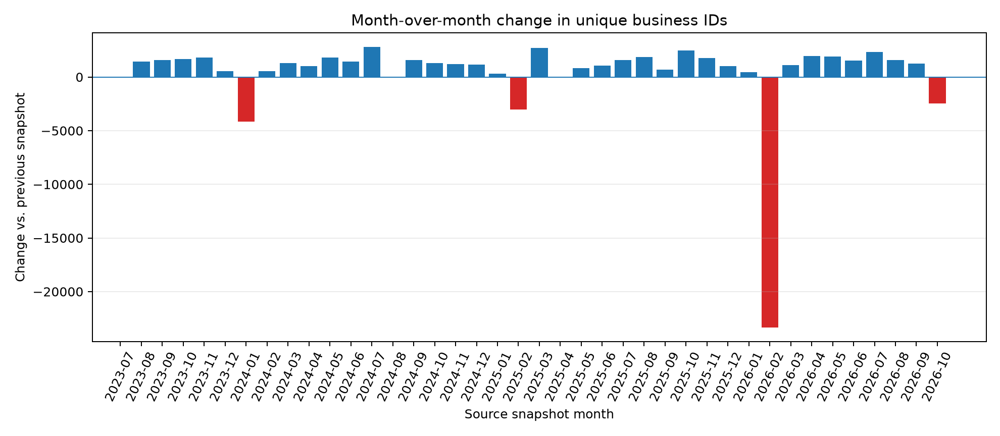
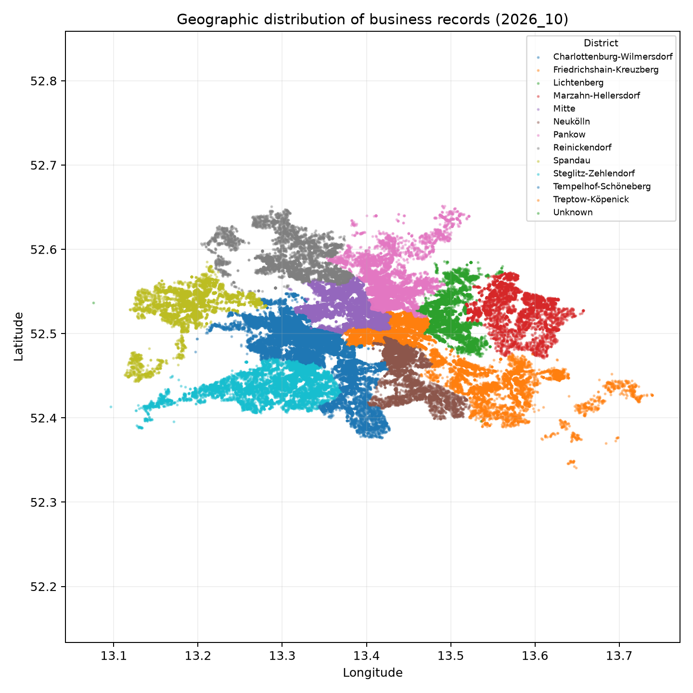
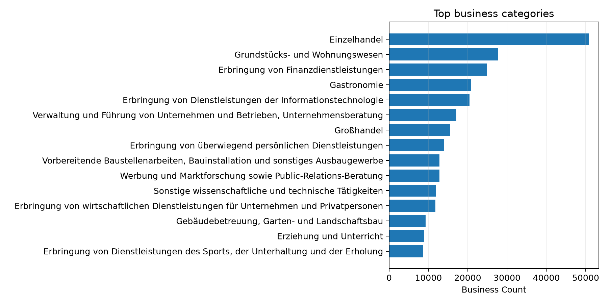
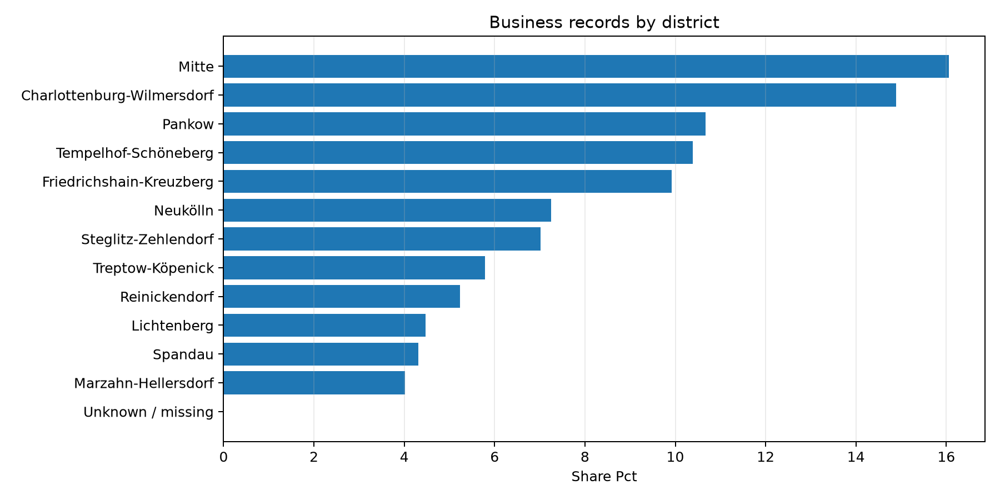

# Standortanalyse von Unternehmen in Berlin
A reproducible data-science project exploring the geographic distribution of businesses in Berlin, differences between districts and planning areas, and spatial associations between business categories.

The project is designed to keep data preparation, analysis, visualization, and reporting reproducible. Observed spatial associations are descriptive; they do not establish causation.

## Project status
Exploratory analysis includes monthly snapshot trends, geographic distribution, district comparisons, and business-category summaries. Findings remain subject to source-data validation.

## Project questions
- How are registered businesses distributed across Berlin's districts and planning areas?
- Which business categories are most common, and how does category composition differ by district?
- Which categories tend to occur together across planning areas?
- How close are businesses in selected categories to one another?
- How sensitive are spatial results to duplicate coordinates, geocoding, and the unit of analysis?

## Data source
The analysis is intended for the monthly Berlin Chamber of Commerce (IHK Berlin) open-data export on businesses (`Gewerbedaten`). Record the exact download URL, retrieval date, data dictionary, and applicable license/terms in `data/README.md` before publication.

Raw data are not committed to Git. Place source CSV files or the source ZIP in `data/raw/`. Processed data are generated locally and are also excluded from Git by default.

## Project structure
```text
berlin-business-locations/
├── data/
│   ├── raw/                 # Local source files; excluded from Git
│   ├── processed/           # Generated tables; excluded from Git
│   └── README.md
├── notebooks/
│   ├── 01_data_quality.ipynb
│   ├── 02_business_distribution.ipynb
│   └── 03_spatial_analysis.ipynb
├── reports/
│   ├── figures/
│   └── README.md
├── src/berlin_businesses/
│   ├── __init__.py
│   ├── config.py
│   ├── data.py
│   ├── analysis.py
│   └── visualize.py
├── scripts/run_pipeline.py
├── tests/
│   ├── test_data.py
│   └── test_analysis.py
├── .gitignore
├── pyproject.toml
└── requirements.txt
```

## Requirements
- Python 3.11 recommended
- Git
- Source data placed in `data/raw/`

## Setup (Windows PowerShell)
```powershell
python -m venv .venv
.\.venv\Scripts\Activate.ps1
python -m pip install --upgrade pip
pip install -r requirements.txt
pip install -e .
```

## Add source data
Place the IHK Berlin CSV files or ZIP export in `data/raw/`. The loader supports CSV files and ZIP archives containing CSV files. Confirm the source schema and provenance before running the pipeline.

## Run
From the repository root:
```powershell
python scripts/run_pipeline.py
```

Open notebooks in VS Code or Jupyter and select the project's `.venv` Python interpreter.

## Current analysis plan
1. Validate schema, missingness, duplicate records, coordinate ranges, and temporal coverage.
2. Describe counts and category shares by district and planning area.
3. Examine category co-occurrence across planning areas, with clear unit-of-analysis definitions.
4. Explore nearest-neighbour distances and shared coordinates, explicitly discussing geocoding artifacts.
5. Export reproducible tables and figures to `reports/`.

## Interpretation rules
- Counts are not population- or area-normalized density measures.
- Correlation across planning areas is not proof of physical clustering, interaction, or causation.
- Multiple businesses sharing coordinates may reflect multi-tenant addresses or geocoding conventions.
- Distance results depend on coordinate quality, category definitions, sampling, and the unit of analysis.
- Any inferential test must state its null model, randomization unit, number of permutations, and limitations.

## Reproducibility
Use fixed random seeds where sampling is involved. Save analysis parameters and data timestamps with generated outputs. Avoid silently overwriting source files. Keep raw data out of Git and do not publish personal or restricted data.

## License and data attribution
No project license has been selected yet. Before adding a license, decide how the code may be reused. Dataset rights and terms are separate from the repository's code license. Cite the source dataset and review its applicable terms before redistributing data or derived extracts.

## Monthly Trend and Key Findings

This project compares monthly snapshots of unique business IDs in the IHK Berlin Gewerbedaten dataset. These figures are **records/unique IDs present in each snapshot**, not independently verified counts of businesses that opened or closed.




### Key findings

- **Longer-term direction:** the series runs from 2023-07 (351,869 unique IDs) to 2026-10 (366,374). The latest month may be incomplete, so endpoint comparisons need caution.
- **Sharp drop in early 2026:** December 2025 had 380,059 IDs, January 2026 had 380,490, and February had 357,138. January-to-February change was 23,352 IDs (-6.14%).
- **Partial recovery:** September 2026 had 368,841 IDs, above February's 357,138, but below January's 380,490.
- **October 2026:** the snapshot contains 366,374 IDs. Verify that October is a complete monthly snapshot before interpreting the decline from September as a real-world change.
- **Interpretation:** the February discontinuity is a material data-coverage / data-quality signal. Counts alone do **not** prove that this number of real businesses closed. Check source release notes, schema and identifier changes, and snapshot completeness before drawing a causal conclusion.

### Exploratory adjustment caveat

The current trend CSV reports 55 IDs removed from the January 2026 count by the current adjustment rule. This is **not** the previously discussed approximately 27,000-record cohort. Do not describe the adjusted series as removing 27,000 records until the original cohort and rule have been reproduced and verified. Candidate IDs are not confirmed errors.

### Geographic and category views







### Data source and reproducibility

- **Publisher:** IHK Berlin
- **Official data page:** https://www.ihk.de/berlin/service-und-beratung/digitalisierung/open-data-5691102
- **Publisher's dataset repository:** https://github.com/IHKBerlin/IHKBerlin_Gewerbedaten
- **Local source archive analyzed:** `documents-export-2026-10-17.zip`
- **Coverage in the current trend table:** 2023-07 through 2026-10
- **License:** the publisher's repository states CC0. Re-check current source terms and attribution notes before redistributing source files or derived data.
- The large raw archive is intentionally not committed to this repository. Obtain it from the publisher and place it in `data/raw/` to reproduce the analysis.

The location chart plots valid coordinates from the latest monthly CSV within a broad Berlin bounding box. It is a point distribution, not a street map. Overlapping records may represent multiple records at the same coordinate; shared coordinates are not automatically errors.
