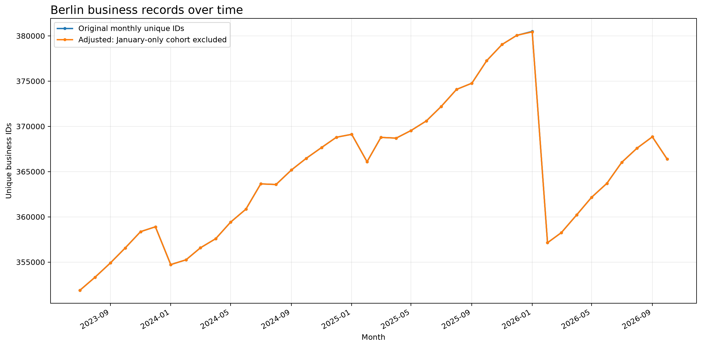

# Standortanalyse von Unternehmen in Berlin
A reproducible data-science project exploring the geographic distribution of businesses in Berlin, differences between districts and planning areas, and spatial associations between business categories.

The project is designed to keep data preparation, analysis, visualization, and reporting reproducible. Observed spatial associations are descriptive; they do not establish causation.

## Project status
Initial project scaffold. Exploratory findings should be regenerated from the source data before being treated as final results.

## Project questions
- How are registered businesses distributed across Berlin's districts and planning areas?
- Which business categories are most common, and how does category composition differ by district?
- Which categories tend to occur together across planning areas?
- How close are businesses in selected categories to one another?
- How sensitive are spatial results to duplicate coordinates, geocoding, and the unit of analysis?

## Data source
The analysis is intended for the monthly Berlin Chamber of Commerce (IHK Berlin) open-data export on businesses (`Gewerbedaten`). Record the exact download URL, retrieval date, data dictionary, and applicable license/terms in `data/README.md` before publication.

Raw data are not committed to Git. Place source CSV files or the source ZIP in `data/raw/`. Processed data are generated locally and are also excluded from Git by default.

## Project structure
```text
berlin-business-locations/
├── data/
│   ├── raw/                 # Local source files; excluded from Git
│   ├── processed/           # Generated tables; excluded from Git
│   └── README.md
├── notebooks/
│   ├── 01_data_quality.ipynb
│   ├── 02_business_distribution.ipynb
│   └── 03_spatial_analysis.ipynb
├── reports/
│   ├── figures/
│   └── README.md
├── src/berlin_businesses/
│   ├── __init__.py
│   ├── config.py
│   ├── data.py
│   ├── analysis.py
│   └── visualize.py
├── scripts/run_pipeline.py
├── tests/
│   ├── test_data.py
│   └── test_analysis.py
├── .gitignore
├── pyproject.toml
└── requirements.txt
```

## Requirements
- Python 3.11 recommended
- Git
- Source data placed in `data/raw/`

## Setup (Windows PowerShell)
```powershell
python -m venv .venv
.\.venv\Scripts\Activate.ps1
python -m pip install --upgrade pip
pip install -r requirements.txt
pip install -e .
```

## Add source data
Place the IHK Berlin CSV files or ZIP export in `data/raw/`. The loader supports CSV files and ZIP archives containing CSV files. Confirm the source schema and provenance before running the pipeline.

## Run
From the repository root:
```powershell
python scripts/run_pipeline.py
```

Open notebooks in VS Code or Jupyter and select the project's `.venv` Python interpreter.

## Current analysis plan
1. Validate schema, missingness, duplicate records, coordinate ranges, and temporal coverage.
2. Describe counts and category shares by district and planning area.
3. Examine category co-occurrence across planning areas, with clear unit-of-analysis definitions.
4. Explore nearest-neighbour distances and shared coordinates, explicitly discussing geocoding artifacts.
5. Export reproducible tables and figures to `reports/`.

## Interpretation rules
- Counts are not population- or area-normalized density measures.
- Correlation across planning areas is not proof of physical clustering, interaction, or causation.
- Multiple businesses sharing coordinates may reflect multi-tenant addresses or geocoding conventions.
- Distance results depend on coordinate quality, category definitions, sampling, and the unit of analysis.
- Any inferential test must state its null model, randomization unit, number of permutations, and limitations.

## Reproducibility
Use fixed random seeds where sampling is involved. Save analysis parameters and data timestamps with generated outputs. Avoid silently overwriting source files. Keep raw data out of Git and do not publish personal or restricted data.

## License and data attribution
No project license has been selected yet. Before adding a license, decide how the code may be reused. Dataset rights and terms are separate from the repository's code license. Cite the source dataset and review its applicable terms before redistributing data or derived extracts.

## Monthly Business Trend

This analysis examines monthly business-record counts in Berlin using historical
IHK Berlin Gewerbedaten snapshots. The chart compares the original monthly series
with an exploratory adjusted series.



### Data source

- **Publisher:** IHK Berlin
- **Official dataset page:** https://www.ihk.de/berlin/service-und-beratung/digitalisierung/open-data-5691102
- **Official dataset repository and archive:** https://github.com/IHKBerlin/IHKBerlin_Gewerbedaten
- **License stated by the publisher:** CC0 (Creative Commons Zero)
- **Local source snapshot used for this analysis:** `documents-export-2026-10-17.zip`
- **Coverage analyzed:** monthly CSV snapshots available from 2023 through October 2026.

The raw archive is not included in this repository because of its size. Obtain the
source files from the official publisher before rerunning the analysis.

### Methodology and limitations

Monthly counts are calculated from the `opendata_id` field in the monthly source
files. The adjusted series is an exploratory comparison based on candidate IDs
associated with the January 2026 anomaly. These candidates have not been
independently confirmed to be erroneous records; therefore, the adjusted series
must not be interpreted as an officially corrected count.

Source data may be revised by the publisher. Results depend on the snapshot date
and the inclusion and exclusion rules used. Check the source archive and analysis
code before comparing results across runs.
